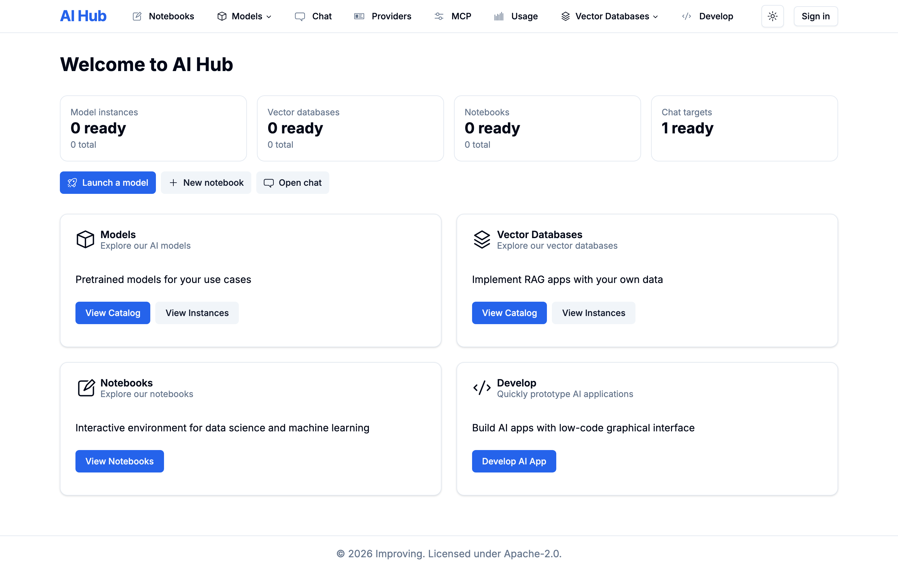
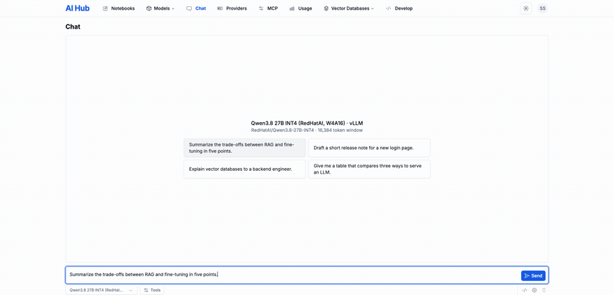
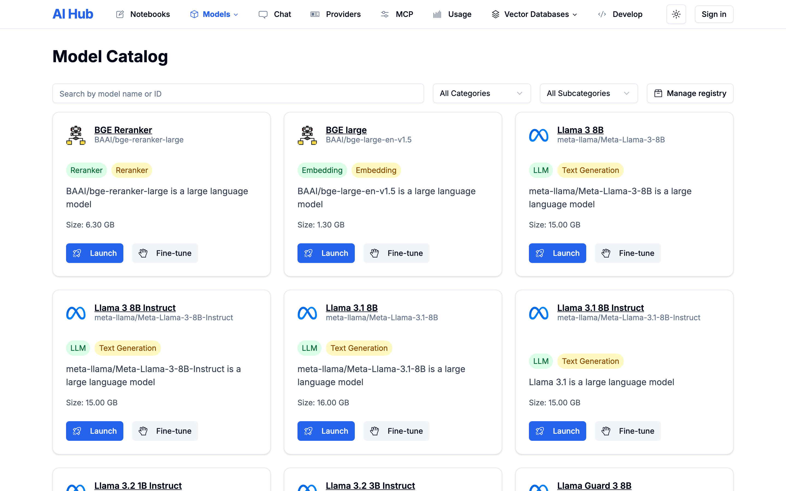
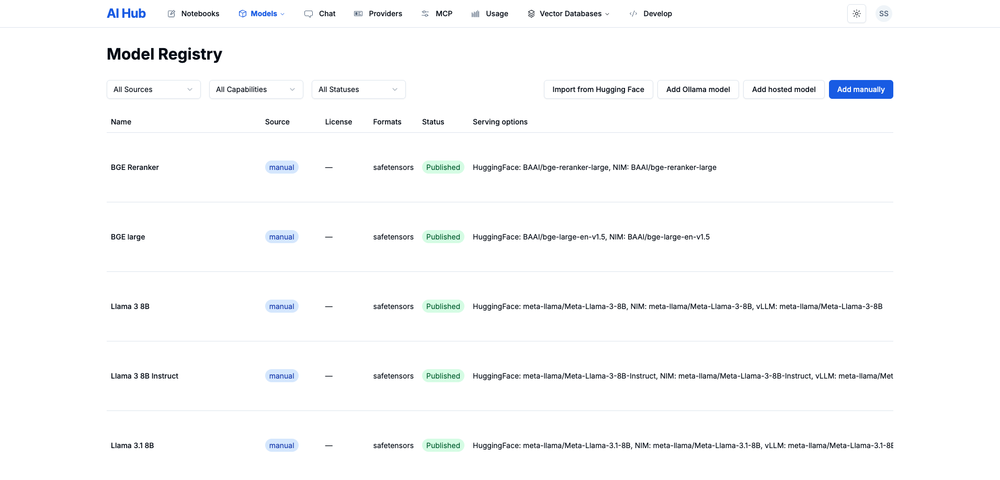
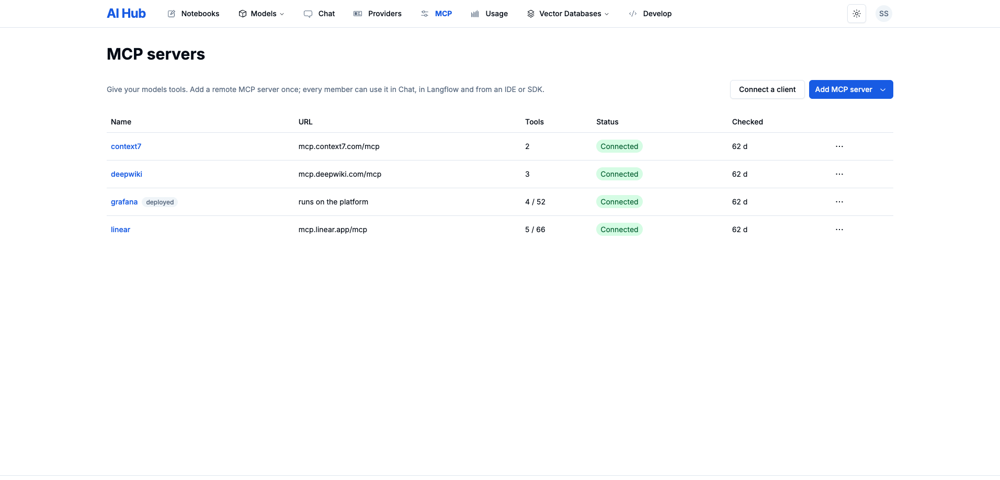
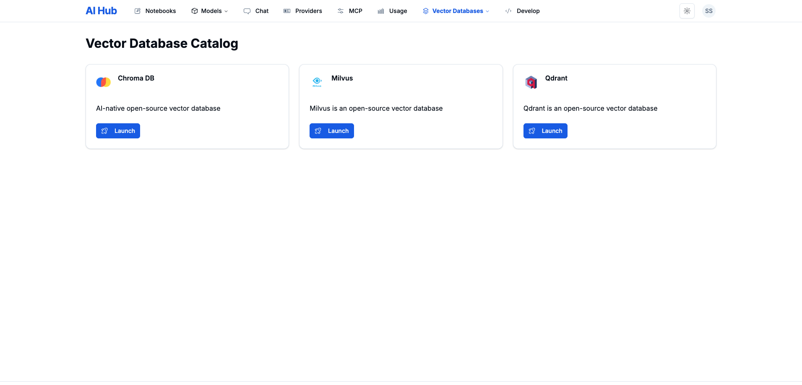
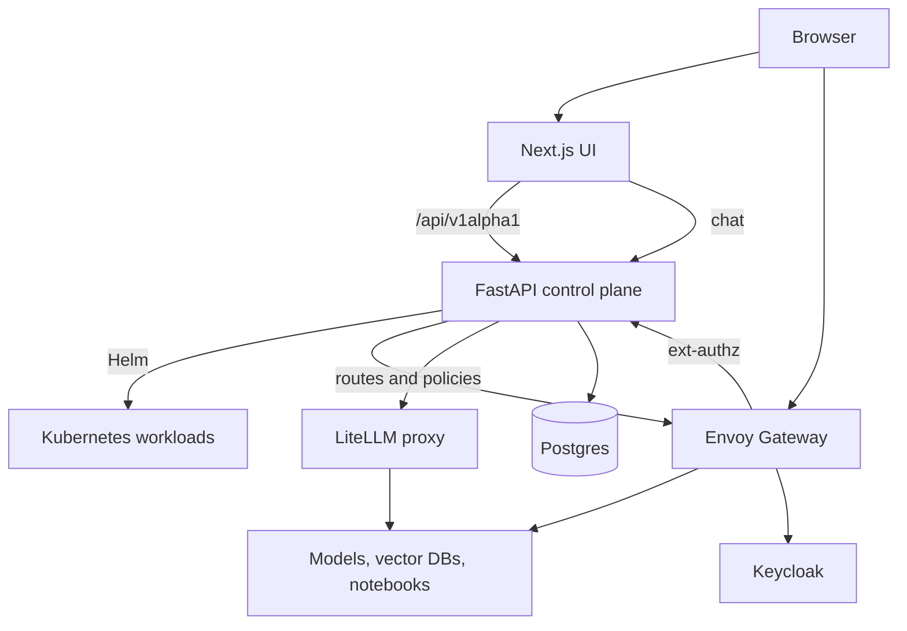

# AIOps Platform

[](https://github.com/improving/aiops-platform/actions/workflows/backend-ci.yml)
[](https://github.com/improving/aiops-platform/actions/workflows/frontend-ci.yml)
[](https://github.com/improving/aiops-platform/actions/workflows/frontend-e2e.yml)
[](https://github.com/improving/aiops-platform/actions/workflows/codeql.yml)
[](LICENSE)

A control plane for AI infrastructure on Kubernetes.
It onboards your clusters and deploys inference engines, vector databases and notebooks through Helm.
Every one of them gets an identity-protected endpoint, a chat surface and a spend meter,
without hand-writing a values file or a route again.



Chat answers stream through the control plane, which records tokens and spend per user:



<details>
<summary>More of the UI</summary>









</details>

## Demo

[AI Hub Product Demo](https://www.youtube.com/watch?v=0BB2aSgnccY) walks through an earlier version of the UI,
recorded before the platform moved to the improving organisation.
The screenshots above show the current one.

## What it does

- **Deploy models, not manifests.**
  Pick a model from a catalog of Hugging Face, Ollama and OpenRouter entries, pick an engine,
  and the platform renders the Helm values and installs the chart.
  Engines: vLLM, Hugging Face TGI and TEI, NVIDIA NIM, OPEA, and Ollama on CPU.
- **Vector databases and notebooks too.**
  ChromaDB, Milvus and Qdrant, plus Kubeflow `Notebook` custom resources, each with its own protected hostname.
- **Every workload gets an identity-protected host.**
  The controllers create an `HTTPRoute` and a gateway `SecurityPolicy` per instance.
  Browsers log in through Keycloak; SDKs use a per-instance API key.
  The authorization decision is a call back to the control plane, not a static allowlist.
- **Chat that goes through the control plane.**
  Every deployed instance is registered in a LiteLLM proxy,
  so answers stream through one place that records tokens and spend per user and per organization.
- **Tools, through MCP.**
  Register remote MCP servers per organization, or let the platform deploy one from a catalog,
  and reach them through a single authenticated endpoint.
- **Multi-tenant from the schema up.**
  Organizations, roles, owner scoping, audit events and personal tokens are part of the model, not an afterthought.

## How the pieces fit



The UI proxies API calls, so there is no CORS setup.
The backend renders Helm values from templates, installs charts, and polls Kubernetes for each instance's endpoint.
Authentication is Keycloak on every route except `/health`.
The gateway asks the backend whether a user may open a workload host.

## Quick start, no GPU

Prerequisites: colima (or another Docker daemon), kind, Helm, kubectl, uv, pnpm.
`make prereqs` reports what is missing.

```bash
colima start --cpu 4 --memory 8
make kind-up gateway-up ca-export auth-up db-up langflow-up
make backend     # terminal 1: API on http://localhost:8000
make frontend    # terminal 2: UI on http://localhost:3000
make e2e-smoke   # terminal 3: creates a Qdrant instance and a notebook, then deletes them
```

Open <http://localhost:3000> and sign in as `alice` / `alice`.
The dev realm also has `bob` and `admin`, with the same password as the username.
Vector databases and notebooks deploy for real into the kind cluster.
GPU inference engines stay catalog-only on a laptop; Ollama runs on CPU and is the one engine that deploys on kind.

curl, Node and Python need to trust the gateway's local CA before they can reach `https://*.127.0.0.1.nip.io`.
Run `make trust-ca` for the command it prints,
or point `SSL_CERT_FILE` and `NODE_EXTRA_CA_CERTS` at `infra/local/ca/ca.crt` for one shell.

## Deploy on Kubernetes

`charts/aiops-platform` installs the whole control plane, with Postgres, Keycloak and LiteLLM bundled or replaced by your own:

```bash
helm repo add infracloud-charts https://infracloudio.github.io/charts
helm upgrade --install aiops-platform infracloud-charts/aiops-platform \
  --namespace aiops-platform --create-namespace \
  --set global.parentDomain=aiops.example.com
```

`docs/install.md` covers the values contract, external dependencies, the gateway objects,
and what a bare-metal cluster needs on top.

## Repository layout

| Directory | Contents |
|---|---|
| `backend/` | FastAPI control plane (Python 3.13, uv, SQLAlchemy 2, pyhelm3) |
| `frontend/` | Next.js 16 UI (React 19, Tailwind 4, shadcn/ui, pnpm) and the Playwright suite |
| `charts/` | The Helm charts the platform installs, published to <https://infracloudio.github.io/charts> |
| `infra/local/` | The kind cluster, gateway, Keycloak, Langflow, LiteLLM and Postgres config for local development |
| `hack/` | Repository-level scripts, including the API smoke test |
| `docs/` | Install and local development guides, the API reference, ADRs and design notes |

## Documentation

- [`docs/install.md`](docs/install.md) — install with Helm, and the values contract
- [`docs/local-dev.md`](docs/local-dev.md) — the local stack, end to end
- [`docs/testing.md`](docs/testing.md) — the two end-to-end tiers
- [`docs/api.md`](docs/api.md) — the API surface
- [`docs/adr/`](docs/adr) — the decisions behind the architecture

## Contributing

Issues and pull requests are welcome.
[`CONTRIBUTING.md`](CONTRIBUTING.md) has the setup, the checks to run and the conventions.
Security problems go through [`SECURITY.md`](SECURITY.md), never a public issue.

## License

Apache License 2.0. See [`LICENSE`](LICENSE) and [`NOTICE`](NOTICE).
