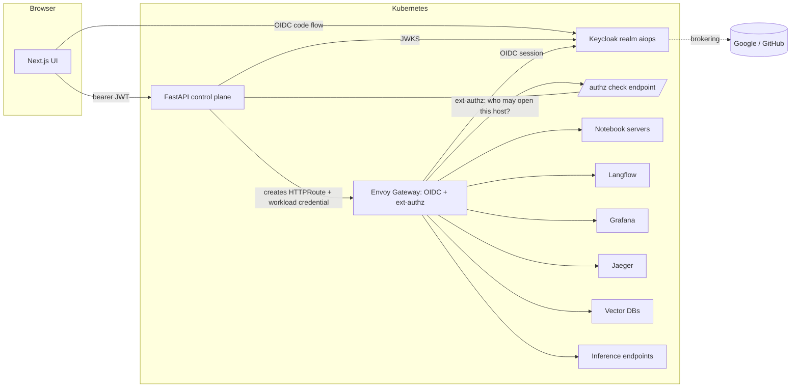

# Authentication and authorization for the AIOps platform

Status: proposed, for review.
Decisions extracted from this document live in `docs/adr/0001` to `0004`.
Versions and vendor facts were checked on 2026-09-04;
items marked *inferred* were reasoned from documentation rather than tested.

## 1. Problem

Nothing in the platform authenticates anyone today.
The UI is open, the API accepts any request, and every deployed workload
(notebooks, Langflow, Grafana, Jaeger, vector databases, inference endpoints)
is reachable by anyone who can reach its Service.
Deployed workloads also need credentials of their own (Hugging Face and NGC tokens),
which are currently process-wide environment variables.

We want:

- login for end users with Google or GitHub, and local accounts that keep working when the lab is offline;
- a control plane that knows who created what, so notebooks and instances belong to a user and an organization;
- every deployed workload protected without patching each upstream project;
- a shape that grows into multi-tenant SaaS (organizations, invitations, isolation) without a rewrite;
- the same mechanisms on the bare-metal lab and on a laptop with kind.

## 2. Vocabulary

| Term | Meaning |
| --- | --- |
| User | A person with an identity in the identity provider (IdP), identified by a stable `sub` claim. |
| Organization | The tenant boundary. Every resource belongs to exactly one organization. Version 1 has a single default organization. |
| Membership | A user's role inside an organization: `admin`, `member` or `viewer`. |
| Owner | The user who created a resource. Owners and organization admins may delete or share it. |
| Session | The browser login state, held by the UI (cookie) and by the gateway (cookie) for deployed workloads. |
| Access token | A short-lived JWT issued by the IdP, presented as a bearer token to the API. |
| Workload credential | A secret the platform generates for one deployed instance (an API key, a database password). It is not a user identity. |
| Automation client | A non-human caller (CI, scripts) that authenticates with IdP client credentials, never with a user's session. |

## 3. Architecture

Three mechanisms, one identity source:

1. **The UI logs users in with OIDC against Keycloak** and keeps a session cookie.
   Its proxy attaches the access token to every `/api/v1alpha1/*` call.
2. **The API validates the JWT** (PyJWT with a cached JWKS), reads `sub`, `email`, `groups` and the organization claim,
   and enforces ownership and roles itself.
3. **Deployed workloads sit behind the gateway.**
   A `SecurityPolicy` per route does the OIDC login (same realm, so users are already signed in)
   and then calls the control plane's authorization endpoint,
   which answers "may this user open this host?" from the ownership tables.
   Workloads receive the identity in headers and never see a password.

Keycloak is the only place identities live.
Google and GitHub are brokered identity providers inside the realm;
local users exist for administrators and for the offline lab.

### 3.1 Prerequisite: stable hostnames and TLS (Phase 0)

OIDC redirects, `Secure` cookies and per-route authorization all need names, not MetalLB addresses.
Today every instance is a `LoadBalancer` Service and its endpoint is `http://<ip>:<port>`
(`backend/utils/kubernetes_utils.py`, `service.type` defaults in `backend/templates/*.jinja`).

Phase 0 introduces one parent domain per environment and a gateway:

| Environment | Parent domain | Gateway exposure | Certificates |
| --- | --- | --- | --- |
| Lab (bare metal, MetalLB) | `*.aiops.<lab-domain>` in the lab DNS | Envoy Gateway Service of type LoadBalancer | cert-manager with an internal CA (or a wildcard certificate) |
| kind on a laptop | `*.127.0.0.1.nip.io` | kind `extraPortMappings` 80/443 to the gateway NodePort | cert-manager self-signed CA trusted locally |

Each instance gets a hostname `https://<kind>-<id8>.<parent>` and an `HTTPRoute` created by its controller;
the stored endpoint becomes that URL.
Keeping everything under one parent domain is also what lets the Grafana and Jaeger iframes
work with `SameSite=Lax` cookies.

No ingress controller is in use today: the lab exposes Services through MetalLB and Kubespray's optional
ingress-nginx add-on was never enabled.
That add-on's upstream project was archived and reached end of life on 2026-03-24,
so Gateway API with Envoy Gateway, the SIG-recommended replacement, is the only option worth adopting.
The platform charts already render an optional `HTTPRoute` (`httpRoute.enabled`) instead of an `Ingress`.

### 3.2 UI login

Two viable patterns were considered.

**A. Application-level OIDC (recommended).**
The Next.js app runs the authorization-code flow with PKCE against Keycloak
(Auth.js v5 with the Keycloak provider, kept behind one `auth` module so the library can be swapped;
Better Auth is the fallback if Auth.js stalls, since it is on a beta tag and in maintenance mode).
The session cookie holds the refresh token server-side; `src/proxy.ts` adds `Authorization: Bearer <access token>`
to rewritten API calls.
Local development keeps `make frontend` and `make backend` on host ports with a Keycloak compose profile;
dev and production log in the same way.

**B. Gateway-level OIDC for the UI too.**
The gateway protects the UI like any workload and forwards the access token in a header.
One mechanism everywhere, but `pnpm dev` on a host port has no login at all,
so development and CI need a bypass and the UI cannot be run without the gateway.

Pattern A is recommended because it keeps development identical to production for the control plane
and gives the UI a real token for API calls.
The gateway still protects everything the platform deploys.

### 3.3 API

- `Authorization: Bearer` is mandatory on every `/v1alpha1/*` route except `/health`.
- Validation: PyJWT `PyJWKClient` against `https://<keycloak>/realms/aiops/protocol/openid-connect/certs`,
  audience `aiops-api`, clock skew of 60 s, keys cached and rotated automatically.
- A `CurrentUser` dependency resolves `sub`, `email`, `name`, `groups`, `org` (from a realm claim mapper)
  and upserts a row in `users` so foreign keys work offline.
- Authorization is enforced in the API, not in the IdP:
  `admin` in an organization sees and manages everything in it,
  `member` manages what they own and sees the rest,
  `viewer` reads only.
- The same dependency serves the gateway's ext-authz endpoint (`GET /v1alpha1/authz/route?host=...`),
  which maps a hostname to a resource and applies the same rules.
- Automation clients use OAuth2 client credentials issued by Keycloak (a confidential client per system);
  the API treats them as service identities scoped to one organization.
  Personal access tokens are deferred (ADR 0004).

### 3.4 Deployed workloads

| Workload | Phase | Mechanism |
| --- | --- | --- |
| Notebook servers (Jupyter, VS Code) | 2 | Gateway OIDC + ext-authz, owner or organization admin only. WebSocket upgrades pass through the gateway (*inferred* single check at upgrade). The standalone notebook controller enforces nothing itself. |
| Langflow | 2 | Gateway OIDC, any member. `LANGFLOW_AUTO_LOGIN=true` stays for version 1 only because the gateway is its sole ingress; version 2 turns it off and uses Langflow API keys per user. |
| Grafana | 2 | Grafana's own `auth.generic_oauth` against the same realm (role mapping from groups), so dashboards and embedded panels share the SSO session. |
| Jaeger | 2 | Gateway OIDC, any member. Jaeger has no auth of its own. |
| Vector DBs (Qdrant, ChromaDB, Milvus) | 3 | Gateway OIDC for the HTTP UI, plus a per-instance workload credential (Qdrant API key, Milvus user and password) generated by the control plane, stored in a Kubernetes Secret, shown once to the owner. |
| Inference endpoints (vLLM, TGI, NIM) | 3 | Per-instance API key set on the server (`--api-key`, `VLLM_API_KEY`) and enforced again at the gateway, because vLLM documents that its flag protects only `/v1`. |
| Fine-tune jobs | 1 | Owned rows; logs and deletion go through the API only. |

The full Kubeflow distribution on the lab cluster (`infra/charts/kubeflow`) brings its own Dex, oauth2-proxy and Istio.
The platform's stack is independent of it and does not reuse Dex;
both can coexist as long as Kubeflow's Istio gateway does not claim the platform's notebook routes.
Kubeflow's `Notebook` v1 CRD is in maintenance with end of life expected late 2026 (Notebooks 2.0 `Workspace` replaces it);
that affects notebook provisioning, not this design, and is recorded as an open question.

### 3.5 Data model changes

Every resource table gains `org_id` and `owner_id` (`notebooks`, `vectordb_instances`, `inference_instances`,
`finetunes`, `model_adapters`; catalogs stay global).
New tables: `organizations` (id, slug, name, idp_org_id), `users` (sub, email, name, last_seen),
`memberships` (user, org, role), `workload_credentials` (resource, kind, secret name, created_at, shown_at).
A migration creates the default organization and backfills existing rows to it with a null owner.
This is the moment to add Alembic; the home-grown schema sync in `db/db.py` cannot express a backfill.

Keycloak Organizations (GA since 26.0) is the source of truth for tenancy once Phase 4 starts;
the platform tables mirror it as a cache keyed by the IdP organization id.

### 3.6 Local development and tests

- `make auth-up` starts Keycloak from a compose profile with a realm import
  (dev users `admin`, `alice`, `bob`, the `aiops-ui` public client, the `aiops-api` audience,
  optional Google and GitHub client secrets from `.env`).
- `make gateway-up` installs Envoy Gateway on kind with the `*.127.0.0.1.nip.io` parent domain and a local CA.
- The Playwright fast tier runs without a cluster and without an IdP:
  the backend and the UI accept `AUTH_MODE=disabled` only when `TEST_MODE=true` is also set,
  and both log a warning at startup.
- The cluster tier logs in for real through the dev realm (Playwright fills the Keycloak form once and reuses storage state),
  and one scenario opens a notebook through the gateway as its owner and is refused as another user.

## 4. Phases

| Phase | Delivers | Proof |
| --- | --- | --- |
| 0 | Parent domain, cert-manager, Envoy Gateway on kind and lab, `HTTPRoute` per instance, ClusterIP defaults, endpoints as URLs | smoke and e2e reach Qdrant and a notebook through the gateway hostname |
| 1 | Keycloak (operator on the lab, compose locally), UI login, API JWT validation, `org_id` and `owner_id`, Alembic, default organization backfill | e2e: login, create a notebook, another user cannot see it |
| 2 | Gateway OIDC and ext-authz for notebooks, Langflow, Jaeger; Grafana OIDC | e2e: owner opens the notebook, non-owner gets 403 |
| 3 | Workload credentials for vector DBs and inference endpoints, shown once in the UI | e2e: Qdrant rejects a call without the key, accepts it with the key |
| 4 | Organizations, invitations through Keycloak, automation clients, namespace-per-organization | e2e: two organizations cannot list each other's instances |

Out of scope for all phases: external secret stores (Vault, external-secrets), SAML for customers,
personal access tokens, per-request rate limiting and billing.

## 5. Options considered

| Concern | Chosen | Rejected and why |
| --- | --- | --- |
| Identity provider | Keycloak 26.7 (Apache 2.0, Organizations GA, brokering, local users, operator) | Dex: broker only, no local users, so nothing works offline. Zitadel 4.x: better native organizations but AGPL-3.0 core since v3. Authentik, Casdoor, Logto: smaller ecosystems. Ory: four services and no admin UI. Auth0, Clerk, WorkOS, Okta, Entra: every login needs their cloud, fails offline. |
| Workload enforcement | Envoy Gateway 1.9 `SecurityPolicy` with `oidc` and `extAuth` chained | oauth2-proxy per host: works, but one instance and cookie secret per hostname and no per-resource policy. ingress-nginx `auth-url`: retired, one auth URL per Ingress. Istio ext-authz: CUSTOM policies cannot read JWT claims directly and the lab's Istio belongs to Kubeflow. Pomerium: capable, but a second policy language next to Gateway API. |
| UI login | Application-level OIDC (pattern A) | Gateway-level OIDC for the UI (pattern B): fewer parts, but no login in local development and no token for direct API calls. |
| API token validation | PyJWT with JWKS | `python-jose`: unmaintained. `fastapi-oidc`: thin and lightly maintained. Opaque tokens with introspection: an IdP round trip per request. |
| Non-browser access | IdP client credentials for automation, per-instance keys for workloads | Platform-minted JWTs: a second issuer to secure and rotate. Long-lived personal tokens: deferred until there is a CLI. |

## 6. Open questions

1. Parent domain and DNS for the lab: who owns `<lab-domain>` and can add a wildcard record?
2. Keycloak sizing: 2 GB memory per replica is the vendor recommendation for small production; confirm the lab nodes can spare it.
3. Notebooks 2.0: when the `Notebook` v1 CRD reaches end of life the notebook controller and chart change; the gateway design is unaffected.
4. Langflow per-user isolation: version 2 needs Langflow API keys per user or one Langflow per organization.
5. Should the fast e2e tier run Keycloak instead of `AUTH_MODE=disabled`? It adds about 30 s of startup and removes a bypass flag from production code.

## 7. Sources

- Keycloak releases and Organizations status: <https://www.keycloak.org/2026/07/keycloak-2670-released>
- Keycloak memory guidance: <https://docs.redhat.com/en/documentation/red_hat_build_of_keycloak/26.0/html/server_configuration_guide/containers->
- Envoy Gateway OIDC and ext-authz chaining: <https://github.com/envoyproxy/gateway/discussions/2425>
- ingress-nginx retirement: <https://www.kubernetes.io/blog/2025/11/11/ingress-nginx-retirement/>
- oauth2-proxy per-host limitation: <https://github.com/oauth2-proxy/oauth2-proxy/issues/3330>
- Istio ext-authz and claims: <https://istio.io/latest/docs/reference/config/security/request_authentication/>
- Kubeflow 1.10 oauth2-proxy: <https://blog.kubeflow.org/kubeflow-1.10-release/>
- vLLM security notes: <https://docs.vllm.ai/en/latest/usage/security/>
- Zitadel license change: <https://zitadel.com/blog/zitadel-v3-announcement>
- Langflow SSO status: <https://github.com/langflow-ai/langflow/issues/2855>
