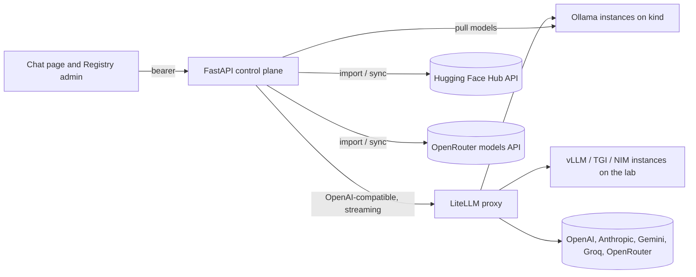

# Small models on kind, chat, providers and a managed model registry

Status: accepted (PR #3).
Phase 1: `docs/superpowers/plans/2026-09-05-models-chat-phase1.md` (PR #4).
Phase 2a (LiteLLM for deployed instances): `docs/superpowers/plans/2026-09-05-models-chat-phase2a-litellm.md`.
Phase 2b (hosted providers, budgets, Providers page): `docs/superpowers/plans/2026-09-05-models-chat-phase2b-providers.md` (same branch and PR as 2a).
Phase 3 (registry, importers, export): `docs/superpowers/plans/2026-09-05-models-chat-phase3-registry.md` (branch `feat/models-registry`).
Phase 4 (lab GPU engines, Envoy AI Gateway) stays lab-only.
Decisions extracted from this document live in `docs/adr/0005` to `0007`.
Facts were checked on 2026-09-05; items marked *unverified* come from documentation, not from a test on this stack.

## 1. Problem

Today the platform deploys GPU-only inference engines (TGI, vLLM, NIM, OPEA), so nothing can run on the kind stack;
the model catalog is a flat CSV seeded at start (name, Hugging Face id, category, size) with a manual "Import Model" form;
and there is no way to talk to a model from the UI.

We want:

1. small chat models that run on the kind stack (4 CPUs, 8 GiB, no GPU, arm64 on laptops, amd64 in CI and the lab)
   with a basic chat interaction in the UI;
2. more than one "provider": models the platform deploys, and hosted APIs (OpenAI, Anthropic, Gemini, Groq, OpenRouter);
3. a model registry that admins manage in the UI, fed by importers, with a reviewable export in git.

## 2. Vocabulary

| Term | Meaning |
| --- | --- |
| Registry entry | A model the platform knows about: identity, source, license, size, capabilities. Not deployed by itself. |
| Provider | Where a model can be served from. Two kinds: an *engine* the platform deploys (Ollama, vLLM, TGI, NIM, OPEA) or a *hosted API* reached with an API key. |
| Inference instance | A deployed engine running one or more registry entries, reachable through the gateway. Exists today. |
| Chat target | What a chat talks to: an inference instance plus a model name, or a hosted provider plus a model name. |
| Importer | Code that turns an external source (Hugging Face Hub, OpenRouter, LiteLLM pricing data) into registry entries. |

## 3. Architecture

Three additions, one new component:

1. **Ollama becomes an engine** (`ollama` in the engine table, capability `llm`, `cpu: true`).
   An instance is one Ollama server that can hold several models; the controller installs it with the platform's own
   `charts/ollama` (small models pre-pulled through values) and the registry can pull more models into it later through
   Ollama's `/api/pull`. It joins the gateway like every instance (API-key host for SDKs, no browser host).
2. **LiteLLM proxy is the provider layer.** Every chat target is registered in LiteLLM as a model entry:
   local instances with their in-cluster URL and workload credential, hosted models with the provider key.
   The control plane calls LiteLLM only; the browser never sees provider keys or LiteLLM.
3. **The registry lives in the database and is edited in the UI**, fed by importers, and exported to
   `backend/raw_data/models.yaml` with `make registry-export` so changes are reviewable in pull requests;
   the file seeds an empty database (replacing `models.csv`).

### 3.1 Engine for kind: Ollama

| Aspect | Ollama | llama.cpp server (alternative) |
| --- | --- | --- |
| Models per pod | many, pulled by name (`qwen2.5:1.5b-instruct`) | one per pod, `-hf owner/repo:quant` |
| Chart | community `otwld/ollama-helm` exists; we ship a thin `charts/ollama` of our own for control | none official |
| Images | multi-arch, 2.6 GiB arm64 | multi-arch, small |
| Model management | `/api/pull`, `/api/tags`, `/api/delete` | none |
| API | OpenAI-compatible `/v1/chat/completions` with SSE | same |
| Memory for a 1B Q4 model | about 1 to 2 GiB | about the model size plus headroom |

Ollama's model management API is what makes "easy manage/update" possible from the registry, so it is the engine for kind.
llama.cpp stays a documented alternative for a single GGUF from Hugging Face; GPU engines are unchanged.
CPU engines do not require a GPU host: the launch wizard's accelerator step becomes optional for engines flagged `cpu`.

Demo models (all Apache 2.0, Q4 quantized, fit in the 8 GiB stack next to the rest): `qwen2.5:1.5b-instruct` (quality),
`qwen3:0.6b` (speed), `granite4:350m` or `smollm2:1.7b` (third option). Llama 3.2 and Gemma 3 work but carry custom licenses; not bundled.
Tokens per second on 4 CPUs are *unverified* until measured on this stack; the demo shows streaming, not throughput.

### 3.2 Provider layer: LiteLLM proxy

- Runs in the cluster (`litellm` namespace, official Helm chart, MIT core), backed by the existing Postgres for keys and spend.
- The control plane holds the LiteLLM master key (Kubernetes Secret) and registers targets through LiteLLM's model API:
  local instances at install (`openai/<model>` with `api_base` = the instance Service URL and the workload credential),
  hosted models when an admin adds a provider key. Unregistering happens on delete.
- Per organization, the control plane creates a LiteLLM virtual key with a budget; chat requests use it, so spend is tracked per organization.
- The API exposes `POST /v1alpha1/chat/completions` (OpenAI schema, streaming SSE) that checks the user may use the target
  (organization membership; owner for instances the org restricts) and forwards to LiteLLM with the org key.
- Alternatives: a thin adapter in the backend (OpenAI passthrough plus Anthropic and Gemini translators) is less infrastructure but
  re-implements retries, provider quirks and cost tracking; Envoy AI Gateway adds token rate limiting at the gateway layer and can come later.

### 3.3 Registry

Tables replace the flat `models` table (Alembic migration, existing rows migrated as `source: manual`):

- `models`: id, name, display description, `source` (`manual`, `huggingface`, `ollama`, `openrouter`), `source_id`
  (`Qwen/Qwen2.5-1.5B-Instruct`, `qwen2.5:1.5b-instruct`, `openai/gpt-4o-mini`), `license`, `parameters` (count), `context_length`,
  `capabilities` (`chat`, `embedding`, `rerank`, `guard`), `formats` (`safetensors`, `gguf`, `hosted`), `size_bytes`, `tags`,
  `status` (`draft`, `published`, `deprecated`), `synced_at`, `raw` (JSON snapshot from the source), plus `org_id` (global when null).
- `model_serving_options`: model → engine (or hosted provider) it can run on, with the engine-specific reference
  (Ollama tag, HF repo, provider model id) and default arguments. Replaces the implicit "any engine with `llm_support`".
- `providers`: hosted providers per organization: `kind` (`openai`, `anthropic`, `gemini`, `groq`, `openrouter`), display name,
  base URL override, credential Secret name, `enabled`.
- Existing `engines`, `engine_charts`, `engine_default_*` stay, with a `cpu` flag on engines.

Importers (backend, run on demand from the UI and on a schedule for published entries):

| Source | What it gives | Auth |
| --- | --- | --- |
| Hugging Face Hub API | discovery by search, `pipeline_tag`, tags, license, parameter count, GGUF files and sizes | none for public models, `HF_API_TOKEN` for gated |
| OpenRouter `/api/v1/models` | hosted model ids, context length, pricing | none |
| LiteLLM `model_prices_and_context_window.json` | pricing and capability cross-check | none |
| Ollama registry manifests | tag existence and size for a chosen tag | none |

The toolify.ai page is a directory of tools filtered by model, with no machine-readable form; it is not a source.

Admin UI (role `admin`): a Registry page with list, filters (source, capability, status), edit dialog, publish/deprecate,
"Import from Hugging Face" (search box, pick, preview, save as draft), "Add hosted model" (provider + model from OpenRouter or typed),
"Sync" per entry, and a Providers page for keys. Members see published entries in the catalog as today.

### 3.4 Chat

- New page `/chat`: target picker (running instances the user may use, and hosted models of enabled providers),
  model picker for multi-model instances, system prompt, temperature, streamed replies, conversation kept in the browser
  (`localStorage`), a "clear" action. Vercel AI SDK `useChat` with the OpenAI-compatible provider pointed at the platform's
  `/api/v1alpha1/chat/completions` through the existing proxy (bearer attached as today).
- A "Chat" button on inference endpoint pages opens `/chat` with that target preselected.
- No conversation persistence in version 1.

### 3.5 Local development and tests

- `make ollama-up` is not needed: Ollama is deployed as an instance from the catalog like any engine; the smoke test and a cluster
  e2e scenario launch `qwen3:0.6b` on Ollama, wait for Ready, and ask one question through `/v1alpha1/chat/completions`.
- `make litellm-up` deploys LiteLLM with the platform's Postgres; the fast tier stubs LiteLLM with a small OpenAI-compatible mock
  so chat UI tests run without a cluster.
- Registry importer tests use recorded fixtures of the Hugging Face and OpenRouter responses.

## 4. Phases

| Phase | Delivers | Proof |
| --- | --- | --- |
| 1 | Ollama engine and chart, optional accelerator step, backend chat endpoint (OpenAI passthrough to the instance), `/chat` page | e2e: launch `qwen3:0.6b` on kind, ask a question, see a streamed answer |
| 2 | LiteLLM proxy, providers table and Providers page, hosted models in the chat target picker, spend per organization | e2e: OpenAI model answers through the same chat page with a key stored as a Secret |
| 3 | Registry tables and migration, Registry admin page, Hugging Face and OpenRouter importers, YAML export and seed | e2e: import a model from Hugging Face, publish it, launch it on Ollama |
| 4 | Lab GPU engines registered into LiteLLM, Envoy AI Gateway evaluation, scheduled sync | lab only |

## 5. Options considered

| Concern | Chosen | Rejected and why |
| --- | --- | --- |
| CPU engine | Ollama | llama.cpp server: one model per pod, no management API, no chart. LocalAI: heavier, arm64 support *unverified*. vLLM CPU and TGI CPU: not realistic on 4 CPUs (vLLM reserves 4 GiB KV cache by default; TGI is in maintenance). |
| Provider layer | LiteLLM proxy | Thin backend adapter: fewer parts but re-implements provider quirks and cost tracking. Envoy AI Gateway: strong rate limiting, but a second gateway to operate; revisit in Phase 4. |
| Registry source of truth | Database with UI editing and a git export | Git-only YAML: no importers, no admin workflow. CSV as today: no metadata, no sources. |
| Chat UI | AI SDK `useChat` | Hand-rolled SSE reader: more code for the same result. |

## 6. Open questions

1. Budget per organization for hosted providers: a default (for example 10 USD per month) or unlimited until set?
2. Should the registry be global or per organization? Proposed: global entries managed by platform admins, per-organization hosted providers.
3. Which three demo models to preload on the kind stack (proposal in 3.1) and whether to preload at all (2 GiB per model on first pull).
4. Whether Phase 1 should skip LiteLLM entirely (direct passthrough) to ship the demo faster; the design keeps the API shape identical either way.

## 7. Sources

- Ollama releases and API: <https://github.com/ollama/ollama/releases>, <https://github.com/ollama/ollama/blob/main/docs/api.md>
- Ollama Helm chart: <https://artifacthub.io/packages/helm/ollama-helm/ollama>
- llama.cpp server image: <https://github.com/ggml-org/llama.cpp/blob/master/docs/docker.md>
- LiteLLM proxy and chart: <https://docs.litellm.ai/docs/proxy/deploy>
- Envoy AI Gateway: <https://aigateway.envoyproxy.io/>
- Hugging Face Hub API: <https://huggingface.co/docs/hub/api>
- OpenRouter models API: <https://openrouter.ai/docs/api-reference/list-available-models>
- Vercel AI SDK: <https://ai-sdk.dev/docs>
